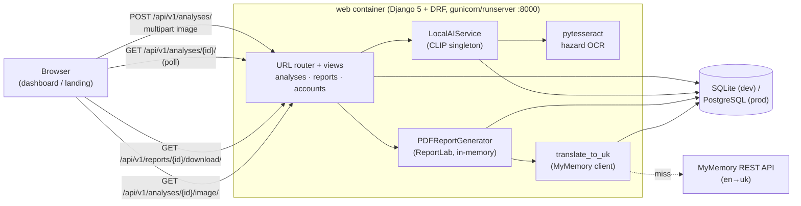
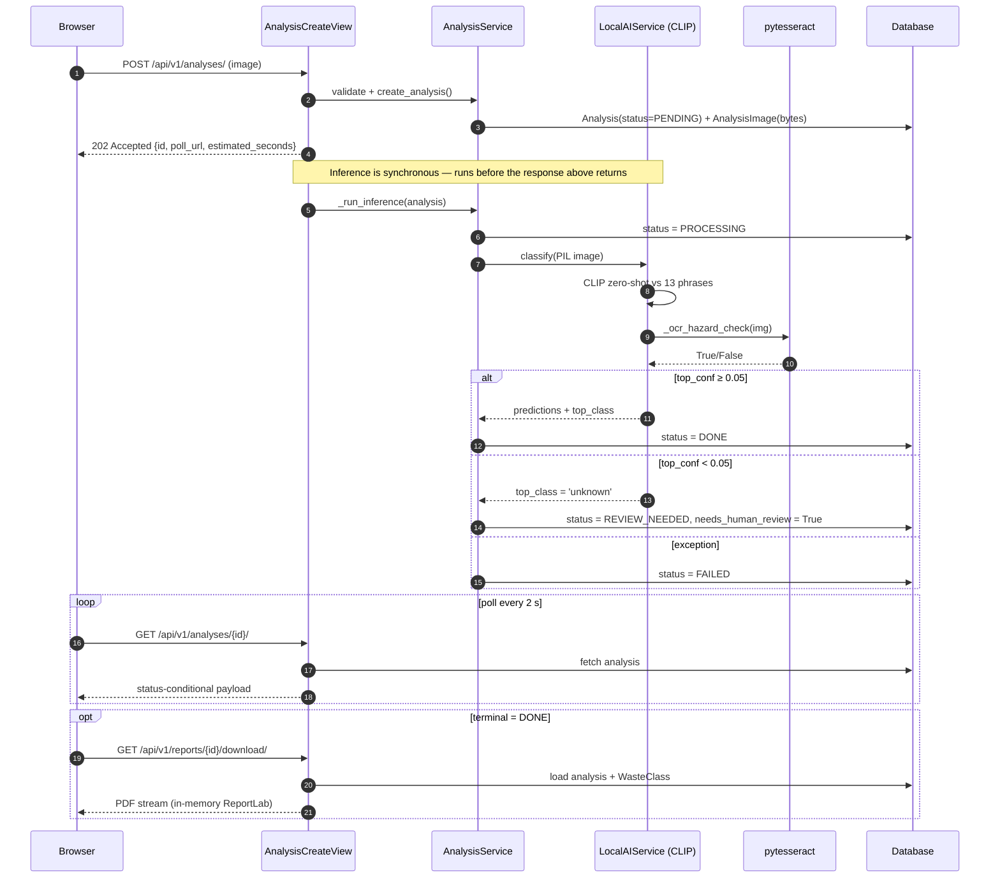
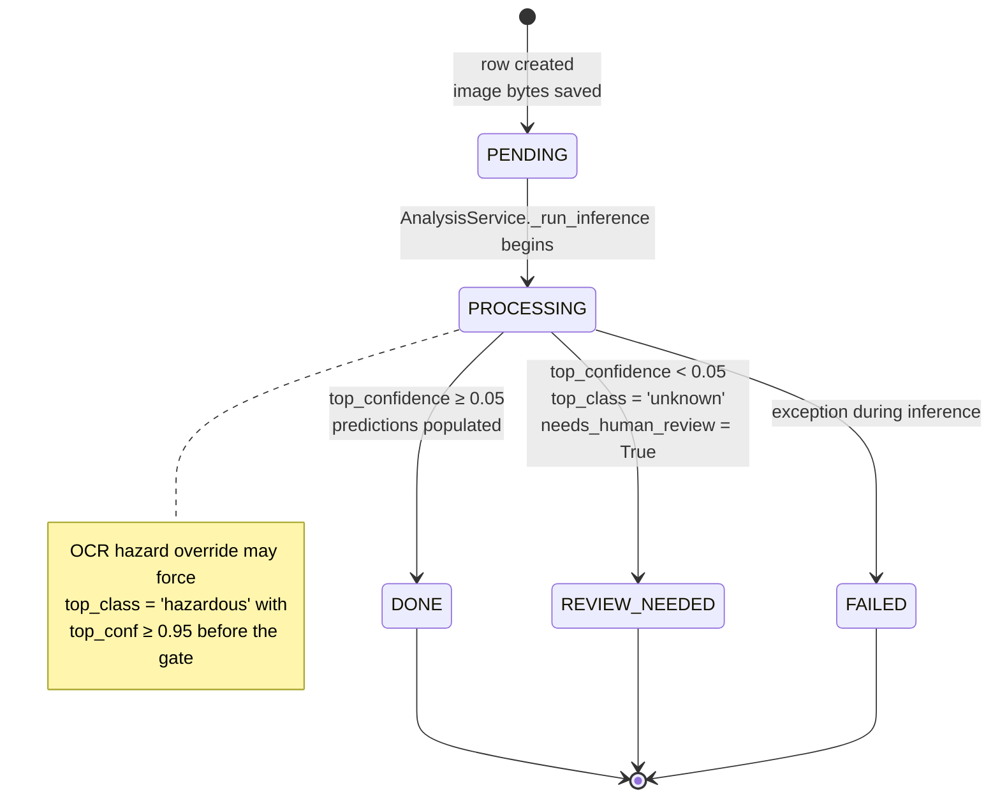
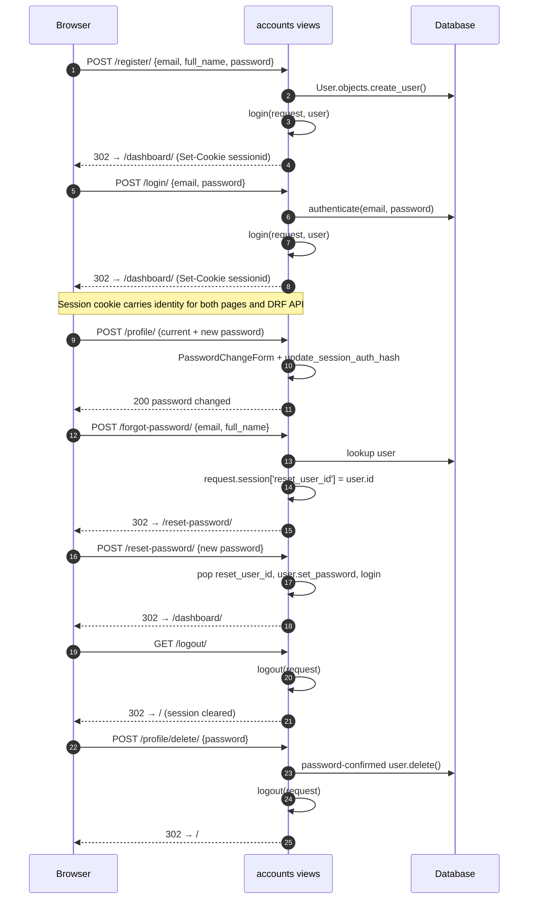
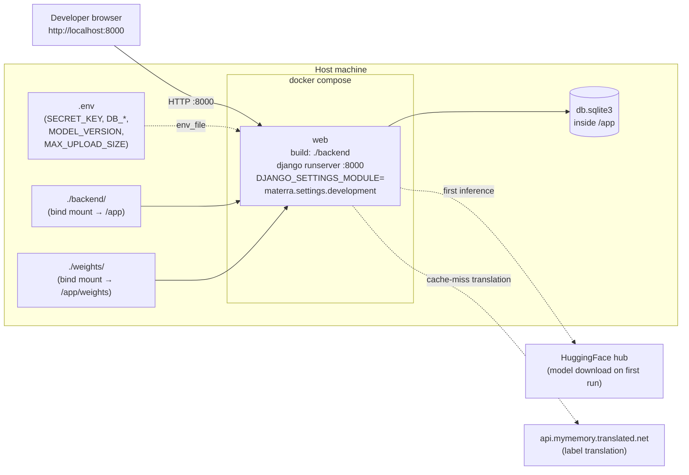

# Materra — Backend Architecture Reference

**Version:** MVP 1.4
**Date:** 2026-06-22
**Scope:** AI inference pipeline, data processing workflow, taxonomy, configuration, translation layer, authentication, deployment, and public landing page

---

## 1. Project Overview

Materra is an automated construction and industrial waste classification service. Its core function is to accept photographic evidence of a waste site or waste container, analyse the visual content using an AI inference pipeline, and resolve the image to one of 14 official internal waste categories. The resulting classification record drives downstream recycling triage: it determines which processing stream the waste is routed to, surfaces an ecological impact score to the end user, and generates a PDF report on demand. Where the model's confidence is insufficient, the record is flagged for human expert review.

The system is a Django 5 REST API backed by a single SQLite database (dev) or PostgreSQL (prod). Clients submit images over HTTP, receive an immediate `202 Accepted` acknowledgement with a polling URL, and check back until the job transitions to a terminal status (`done`, `review_needed`, or `failed`). Inference runs synchronously within the same request cycle. PDF reports are generated on demand at download time — nothing is written to disk.

### 1.1 System Topology

The MVP runs as a single Django process. Inference, OCR, translation and PDF rendering all execute inside the request cycle of the `web` container — there is no worker/queue split today.



---

## 2. Technology Stack

| Component | Technology | Version Constraint |
|---|---|---|
| Web framework | Django | `>=5.0, <5.1` |
| REST layer | Django REST Framework | `>=3.15, <3.16` |
| Image I/O | Pillow | `>=10.2, <10.3` |
| AI inference | HuggingFace `transformers` | `>=4.38, <5.0` |
| Tensor backend | PyTorch | `>=2.2.0` |
| OCR | pytesseract | `>=0.3` |
| PDF generation | ReportLab | `>=4.1` |
| Chart rendering | Matplotlib | `>=3.8` |
| Translation | MyMemory REST API | (no dependency — stdlib `urllib`) |
| Database | SQLite (dev) / PostgreSQL (prod) | psycopg2-binary `>=2.9` |

### 2.1 Inference Engine

The active inference engine is the HuggingFace `transformers` **zero-shot image-classification** pipeline, initialised with the **`openai/clip-vit-base-patch32`** backbone:

```python
from transformers import pipeline

cls._model = pipeline(
    'zero-shot-image-classification',
    model='openai/clip-vit-base-patch32',
    device=-1,       # -1 → CPU; CUDA is never attempted
)
```

CLIP (Contrastive Language–Image Pretraining) compares the image's embedding directly against natural-language descriptions of each waste category. This eliminates the keyword mapping layer that was required with the previous ResNet-50 approach, and gives full coverage of all 13 real waste slugs — including `asphalt`, `gypsum`, and `insulation`, which were unreachable with the prior model.

**Rationale:**

- **Full domain coverage.** Natural-language candidate phrases can describe any material class, including those with no ImageNet analogue.
- **No mapping layer needed.** Classification is end-to-end: image → score per candidate phrase → waste slug. No three-tier keyword resolution.
- **CPU efficiency.** CLIP ViT-B/32 is compact and runs in 200–800 ms on a modern CPU core without a GPU.
- **Stable output format.** The pipeline returns a list of `{label: str, score: float}` dicts sorted by score descending, with all candidates scored simultaneously.

---

## 3. Data Processing Workflow

The end-to-end lifecycle of an analysis request proceeds through the following stages:

```
Client
  │
  │  POST /api/v1/analyses/
  │  Content-Type: multipart/form-data
  │  Body: image=<file>
  │
  ▼
AnalysisCreateView  (apps/analyses/views.py)
  │
  ├─ 1. VALIDATION
  │      AnalysisService._validate_image()
  │      ├─ Content-Type header check (jpeg / png / webp only)
  │      ├─ File size check (≤ 10 MB)
  │      ├─ Magic byte verification (JPEG FF D8 FF / PNG 89 50 4E / WebP RIFF…WEBP)
  │      └─ Pillow structural integrity check (img.verify())
  │
  ├─ 2. PERSISTENCE
  │      ├─ Analysis.objects.create(status=PENDING, user=<authenticated user or None>)
  │      └─ AnalysisImage.objects.create(image_data=<bytes>, content_type=<mime>)
  │         Image bytes are stored in the database — no filesystem writes.
  │         Returns 202 Accepted → {id, status, poll_url, estimated_seconds}
  │
  └─ 3. INFERENCE  (AnalysisService._run_inference)
         │
         ├─ SET status = PROCESSING  →  save(update_fields=[…])
         │
         ├─ Load image bytes from AnalysisImage → io.BytesIO → PIL.Image
         │
         ├─ LocalAIService.classify(pil_image)
         │      │
         │      ├─ Lazy-load CLIP pipeline (singleton; loaded once per process)
         │      ├─ image.convert('RGB')
         │      ├─ pipeline(img, candidate_labels=<13 phrases>)
         │      │    → raw_results: [{label, score}, …] sorted by score descending
         │      ├─ top_slug = phrase_to_slug[raw_results[0]['label']]
         │      ├─ OCR hazard override: _ocr_hazard_check(img) via pytesseract
         │      │    → if any hazard keyword found, top_slug = 'hazardous', top_conf ≥ 0.95
         │      └─ Confidence gate check  (see §7)
         │
         ├─ ON SUCCESS
         │      ├─ top_confidence ≥ 0.05 AND slug ≠ 'unknown'
         │      │    → status = DONE,          needs_human_review = False
         │      └─ top_confidence < 0.05
         │           → status = REVIEW_NEEDED, needs_human_review = True
         │
         └─ ON EXCEPTION
                → status = FAILED  (traceback printed to stderr for diagnosis)


Client polls  GET /api/v1/analyses/{uuid}/
  └─ Returns status-conditional payload:
       PENDING / PROCESSING  →  {id, status, created_at}
       DONE                  →  full result payload + ecological_score + report_url
       REVIEW_NEEDED         →  base + needs_human_review: true
       FAILED                →  base only

Client downloads  GET /api/v1/reports/{uuid}/download/
  ├─ PDFReportGenerator(analysis).generate() — built in memory, never written to disk
  ├─ Default      → streams PDF inline (Content-Disposition: inline)
  ├─ ?download=1  → attachment mode (save to disk)
  └─ ?format=json or Accept: application/json → JSON analysis payload
```

### 3.1 Request Sequence



### 3.2 Analysis Lifecycle



---

## 4. Dashboard Live Update Behaviour

After a successful analysis the dashboard UI updates **without a full page reload**. Two parallel updates fire the moment the poll endpoint returns a terminal status:

### 4.1 KPI Cards (stats row)

`_updateKpiAfterUpload(status, isHazardous, ecoScore)` increments the counters directly in the DOM:

| Counter | Trigger |
|---|---|
| Total analyses (`kpi-total`, `kpi-pill`) | Every terminal result |
| Completed successfully (`kpi-done`) | `status === 'done'` |
| Awaiting review (`kpi-review`) | `status === 'review_needed'` |
| Hazardous materials (`kpi-hazardous`) | `is_hazardous === true` |
| Average ecological score (`kpi-eco`) | `ecological_score != null` |

### 4.2 History Table Row

`_insertTableRow(data)` prepends a fully-formed `<tr>` to the history table immediately after the KPI update:

- The new row contains the uploaded image thumbnail (via `GET /api/v1/analyses/{uuid}/image/`), the formatted timestamp, the Ukrainian waste-class label, the status badge, and all action buttons (Details, PDF if applicable, Delete).
- After insertion all rows are **re-sorted by date descending** so the new entry always leads the table, and the sort-header visual is reset to `↓` on the date column.
- Active type/status filters are **preserved**: `applyFilters()` re-runs against the current filter state, so the new row is shown or hidden according to whatever checkboxes the user had checked before uploading.
- If no history table exists yet (first-ever analysis for this user), the full table structure (thead, tbody, pagination bar) is created dynamically, the empty-state placeholder is removed, and `initTableBehaviors()` wires up all sort/filter/pagination event listeners on the freshly created DOM.

The modal close button and the "← Повернутись до дашборду" button no longer trigger `location.reload()` — the page state is already consistent after the two live updates above.

### 4.3 Thumbnail Lightbox

Clicking any thumbnail in the history table or the result modal opens a full-screen lightbox overlay (`#imgLightbox`) with the image scaled up to 90 vw × 88 vh on a blurred dark backdrop. The handler is delegated on `document`, so it fires for both server-rendered rows and rows inserted live by `_insertTableRow`. The lightbox closes on backdrop click or the `Escape` key.

### 4.4 PDF Link Behaviour

PDF action buttons (`mPdfLink` in the result modal and the `PDF` action button in the history table) link to `/api/v1/reports/{uuid}/download/` **without** the `?download=1` query parameter and carry `target="_blank" rel="noopener"`. The report opens inline in a new browser tab rather than triggering a file download. The `?download=1` mode is still supported by the endpoint but is not used from the UI.

---

## 5. Image Storage

Images are stored as binary data in the `AnalysisImage` database table — there is no local filesystem dependency and no `MEDIA_ROOT`.

### 5.1 Data Model Overview

The database holds five real tables: `User`, `Analysis`, `AnalysisImage`, `WasteClass`, and `LabelTranslation`. The image blob lives on a separate table from `Analysis` so list queries never load bytes by accident, and `WasteClass.code` is the join key for the slugs CLIP outputs.

```mermaid
erDiagram
    USER ||--o{ ANALYSIS : "uploads (nullable FK)"
    ANALYSIS ||--|| ANALYSIS_IMAGE : "1:1 OneToOne (PK)"
    ANALYSIS }o..|| WASTE_CLASS : "top_class = code (no FK)"
    LABEL_TRANSLATION }o..o{ ANALYSIS : "raw_label_en lookup (no FK)"

    USER {
        uuid id PK
        email email UK "USERNAME_FIELD"
        string full_name
        bool is_active
        bool is_staff
        datetime created_at
    }
    ANALYSIS {
        uuid id PK
        uuid user_id FK "nullable — anonymous uploads allowed"
        string status "pending|processing|done|review_needed|failed"
        string image_filename
        int image_size_bytes
        json predictions "list of {class, confidence, label_uk, raw_label}"
        string top_class "WasteClass.code"
        float top_confidence
        string model_version
        int inference_time_ms
        bool needs_human_review
        text notes
        datetime created_at
        datetime updated_at
    }
    ANALYSIS_IMAGE {
        uuid analysis_id PK_FK "OneToOne, CASCADE"
        bytes image_data "≤ 10 MB"
        string content_type
        datetime created_at
    }
    WASTE_CLASS {
        uuid id PK
        string code UK "concrete|brick|metal|…|unknown"
        string label_uk
        string label_en
        text recycling_method
        int ecological_score "1–10, nullable"
        bool is_hazardous
        datetime created_at
    }
    LABEL_TRANSLATION {
        int id PK
        string raw_label_en UK "CLIP candidate phrase"
        string translated_uk
        bool is_manual "admin-corrected; never overwritten"
        datetime created_at
        datetime updated_at
    }
```

### 5.2 Database Model

```
AnalysisImage
  analysis_id   → OneToOneField(Analysis, primary_key=True, CASCADE)
  image_data    → BinaryField   (raw bytes, up to 10 MB)
  content_type  → CharField     (e.g. 'image/jpeg')
  created_at    → DateTimeField (auto)
```

`AnalysisImage` lives in a separate table from `Analysis` so that list queries on the analyses table never load blob bytes unless explicitly requested.

### 5.3 Image Serving

`GET /api/v1/analyses/{uuid}/image/` reads `AnalysisImage.image_data` and streams the bytes with the stored `content_type`. This endpoint is used by the dashboard thumbnail column.

---

## 6. Taxonomy and Classification Logic

### 6.1 The 14 Official Waste Class Slugs

| Slug | Ukrainian Label | Hazardous |
|---|---|---|
| `concrete` | Бетон | No |
| `brick` | Цегла | No |
| `metal` | Метал | No |
| `wood` | Деревина | No |
| `glass` | Скло | No |
| `plastic` | Пластик | No |
| `ceramic_tile` | Керамічна плитка | No |
| `asphalt` | Асфальт | No |
| `gypsum` | Гіпс/Гіпсокартон | No |
| `insulation` | Утеплювач | No |
| `mixed_debris` | Змішані відходи | No |
| `soil` | Ґрунт | No |
| `hazardous` | Небезпечні відходи | **Yes** |
| `unknown` | Невизначено | — (review sentinel) |

`unknown` is not a true waste class; it is a triage sentinel that signals the record must be routed to human review.

### 6.2 CLIP Candidate Phrases

CLIP scores the image against 13 natural-language phrases simultaneously (one per real waste slug). `unknown` has no candidate phrase — it is only assigned when the top confidence falls below the review threshold.

| Candidate phrase | Mapped slug |
|---|---|
| `chunks of concrete or concrete rubble from demolition` | `concrete` |
| `red or clay bricks from masonry or demolition` | `brick` |
| `metal scrap, steel pipes, iron beams or rebar` | `metal` |
| `wooden planks, timber, lumber or wood debris` | `wood` |
| `broken glass panels, glass bottles or glass fragments` | `glass` |
| `plastic pipes, plastic packaging or synthetic construction waste` | `plastic` |
| `ceramic floor tiles or broken porcelain pieces` | `ceramic_tile` |
| `asphalt road surface, bitumen or pavement material` | `asphalt` |
| `gypsum plasterboard, drywall or plaster construction material` | `gypsum` |
| `insulation foam, mineral wool or fiberglass batting` | `insulation` |
| `mixed unsorted construction and demolition debris` | `mixed_debris` |
| `soil, dirt, gravel, sand or excavated earth` | `soil` |
| `hazardous chemical waste barrels or dangerous material drums` | `hazardous` |

### 6.3 OCR Hazard Override

After CLIP inference, `_ocr_hazard_check()` runs pytesseract on the image. If any of the following keywords appear in the extracted text, the result is unconditionally overridden to `hazardous` and `top_confidence` is raised to at least `0.95`:

```
caution, warning, danger, radioactive, toxic, flammable, explosive,
hazmat, poison, corrosive, biohazard, chemical, dangerous, harmful
```

This override fires after CLIP so the OCR cost is paid only once per request. pytesseract is an optional soft dependency — if the binary is missing, `_ocr_hazard_check` silently returns `False` and inference degrades gracefully.

---

## 7. Inference Configuration

### 7.1 Threshold Reference

| Constant | Value | Role |
|---|---|---|
| `_REVIEW_THRESHOLD` | `0.05` (5 %) | If the model's top-phrase confidence falls below this value, the record is classified as `review_needed` and `needs_human_review` is set to `True`. The `predictions` array is returned empty in this path. |
| `_MIN_PRED_CONFIDENCE` | `0.04` (4 %) | Any individual prediction whose raw score falls below this floor is excluded from the output predictions array. Suppresses near-zero entries in the tail. |

### 7.2 Terminal Status Decision Tree

```
classify() returns
  │
  ├─ top_conf < 0.05
  │    → top_class: 'unknown'
  │    → needs_human_review: True
  │    → predictions: []
  │    → DB status: REVIEW_NEEDED
  │
  └─ top_conf ≥ 0.05
       → top_class: <slug>
       → needs_human_review: False
       → predictions: [entries with raw score ≥ 0.04]
       → DB status: DONE
```

---

## 8. Model and Data Domain

### 8.1 Base Model

`openai/clip-vit-base-patch32` is a Vision Transformer trained with contrastive learning on 400 million image–text pairs. Unlike ResNet-50 (trained on 1,000 fixed ImageNet object categories), CLIP has no fixed output vocabulary — it scores any text description against the image in the same embedding space.

### 8.2 Domain Coverage

Because candidate phrases are natural-language descriptions, all 13 real waste slugs are reachable without a mapping layer. There are no structural gaps of the kind that existed with ResNet-50 (where `asphalt`, `gypsum`, and `insulation` had no ImageNet analogue).

| Slug | Reachable via CLIP |
|---|---|
| `concrete` | Yes — phrase describes demolition rubble |
| `brick` | Yes — phrase describes clay/masonry brick |
| `metal` | Yes — phrase describes scrap metal, rebar |
| `wood` | Yes — phrase describes timber, lumber |
| `glass` | Yes — phrase describes broken glass panels/bottles |
| `plastic` | Yes — phrase describes plastic pipes/packaging |
| `ceramic_tile` | Yes — phrase describes floor tiles/porcelain |
| `asphalt` | Yes — phrase describes road surface/bitumen |
| `gypsum` | Yes — phrase describes plasterboard/drywall |
| `insulation` | Yes — phrase describes mineral wool/fiberglass |
| `mixed_debris` | Yes — phrase describes unsorted C&D debris |
| `soil` | Yes — phrase describes dirt/gravel/excavated earth |
| `hazardous` | Yes — phrase describes chemical waste barrels/drums |

---

## 9. Report Generation

### 9.1 PDF Report Pipeline

PDFs are generated **on demand** when `GET /api/v1/reports/{uuid}/download/` is called. `PDFReportGenerator(analysis).generate()` builds the document entirely in memory and returns an `io.BytesIO` buffer that is streamed directly to the client. Nothing is written to disk.

The PDF is produced with **ReportLab** (pure-Python, no system-level rendering libraries required). Cyrillic text is rendered using Arial (Windows) or DejaVu/Liberation Sans (Linux/CI) as a TrueType fallback.

### 9.2 Report Contents

| Section | Content |
|---|---|
| Header | Materra branding, report ID (`MAT-{date}-{short_uuid}`), date and time |
| Metadata row | Analysis UUID (truncated), creation date, model version, inference time |
| Classification result | Top waste class (Ukrainian label), CLIP raw phrase (bilingual — see §11), confidence percentage |
| Hazardous warning | Amber warning box when `is_hazardous = True` |
| Review warning | Amber warning box when `needs_human_review = True` |
| Recycling recommendations | `recycling_method` from the `WasteClass` reference table |
| Ecological score | Colour-coded badge (green ≥ 7, amber ≥ 4, red < 4) with descriptive text |
| Confidence chart | Horizontal bar chart (Matplotlib, top-5 predictions, base64-encoded PNG) |
| Footer | Completion status, model version, report ID |

### 9.3 Download Endpoint

`GET /api/v1/reports/{uuid}/download/`

| Query param | Behaviour |
|---|---|
| _(none)_ | Streams PDF inline (`Content-Disposition: inline`) |
| `?download=1` | Forces attachment mode (save to disk) |
| `?format=json` or `Accept: application/json` | Returns full JSON analysis payload |

---

## 10. Ecological Score Rating

### 10.1 How the Score Is Resolved

`ecological_score` is **not computed at runtime** — it is a static integer column on the `WasteClass` table (nullable, range 1–10). The values are seeded by data migration `apps/analyses/migrations/0006_update_eco_scores.py`, which is the single source of truth.

At read time the code simply joins on `top_class`:

```python
# apps/analyses/views.py — AnalysisDetailView
wc = WasteClass.objects.filter(code=analysis.top_class).first()
ecological_score = wc.ecological_score if wc else None
```

Three places consume the column:

| Consumer | File | Use |
|---|---|---|
| Detail / poll endpoint | `apps/analyses/views.py` | Returns `ecological_score` in the `done` payload |
| Dashboard "Average eco" KPI | `apps/analyses/views.py` `DashboardView` | Mean of stored scores over the user's completed analyses |
| PDF report badge | `apps/reports/generators.py` | Colour-coded badge (green ≥ 7, amber ≥ 4, red < 4) |

### 10.2 Where the Seeded Numbers Come From

The constants in migration 0006 were assigned **offline**, using a three-dimensional weighting against EU data sources. This methodology is documentation only — it does not run anywhere in the codebase. To change a score, write a new data migration.

| Dimension | Weight | Source |
|---|---|---|
| Actual EU material recycling / recovery rate | 40% | Eurostat `cei_wm040`, JRC CDW Report JRC134500 |
| CO₂ / energy savings vs. virgin production or landfill | 35% | ISO 14040/44 LCA framework, EN 15978 Module D, ecoinvent |
| Ease and safety of recycling (contamination, hazard, infrastructure maturity) | 25% | EU C&D Waste Protocol 2016, EU Waste Framework Directive Annex III |

The headline EU CDW recovery figure (≈ 89%) includes low-quality backfilling. Scores reflect **material-quality recycling** only, not aggregate recovery.

### 10.3 Score Table

| Material | Score | EU Recycling Rate | Key Rationale |
|---|---|---|---|
| `metal` | **9** | 85–95% collection | Highest CO₂ savings (58–92% vs. virgin); commodity market ensures near-complete collection; EuRIC data |
| `asphalt` | **9** | ~95% total recovery | Only 5% to EU landfill (EAPA 2022); 28–39% CO₂ savings from RAP incorporation; best-in-class after metal |
| `glass` | **8** | 97% recyclable in theory | Closed-loop technology mature (cullet → float glass); CDW glass collection is the gap, not the technology |
| `brick` | **7** | 30–50% quality recycling | Rest is backfill (low-quality downcycling); mortar contamination limits reuse; JRC CDW study |
| `wood` | **7** | ~37% material-recycled | Majority (~63%) goes to energy recovery, not material recycling; treated wood (CCA, creosote) can be hazardous |
| `concrete` | **7** | Largest CDW fraction | Good LCA profile (12–29% GHG reduction); high-quality RCA uptake still marginal in EU |
| `ceramic_tile` | **6** | < 20% material recycling | No closed-loop pathway; crushing is energy-intensive; no industrial-scale remanufacture |
| `soil` | **6** | Reuse varies | Clean soil is inert re-use, not genuine recycling; contaminated soil requires specialist treatment |
| `gypsum` | **5** | Only 13% recycled | 87% goes to EU landfill despite being 100% theoretically recyclable; H₂S toxicity when landfilled; LIFE Gypsum-to-Gypsum project targets this gap |
| `plastic` | **5** | ~26% material recycling | Polymer complexity (PVC, HDPE, EPS, PUR); flame retardant contamination; PVC chlorine issues |
| `insulation` | **4** | < 15% recycled | Mineral wool primarily landfilled; legacy HBCD flame retardants (POPs); no mature EU recycling supply chain |
| `mixed_debris` | **3** | Low (requires sorting first) | Unsorted stream = contamination risk + mandatory secondary sorting before any recovery pathway |
| `hazardous` | **1** | No recycling pathway | Containment-only (asbestos, PCBs, lead paint); EU WFD Annex III classification; landfilling of ACM is primary disposal route |
| `unknown` | **—** | N/A | Cannot score without material identification |

### 10.4 Key Surprises vs. Intuition

- **Gypsum is the most overrated material** intuitively — chemically 100% recyclable, yet 87% ends up in EU landfills due to separation and logistics barriers.
- **Asphalt is underrated** — it has the highest real-world EU recovery rate of any C&D material (~95%), driven by mature reclaimed asphalt pavement (RAP) infrastructure.
- **Insulation scores below mixed debris** because legacy flame retardants (HBCD, banned but present in pre-2016 demolitions) can legally classify it as hazardous waste.

### 10.5 Sources

- JRC CDW Report JRC134500 — EU Commission Publications Office
- Eurostat C&D waste recovery indicator `cei_wm040`
- EU Construction & Demolition Waste Management Protocol 2016
- EAPA Asphalt Circular Economy Report 2022
- EuRIC Metal Recycling Factsheet 2022
- Glass for Europe — JRC CDW study response
- Plasterboard Sustainability Partnership / LIFE Gypsum-to-Gypsum
- EN 15978 / ISO 14040–44 (LCA methodology)

---

## 11. Label Translation

### 11.1 Purpose

Each prediction record carries a `raw_label` — the CLIP candidate phrase that received the highest score (e.g. `"metal scrap, steel pipes, iron beams or rebar"`). These phrases are shown in the PDF report bilingually: Ukrainian translation first, English original in parentheses. If the translation equals the original (API fallback), only English is shown.

### 11.2 Translation Flow

```
translate_to_uk(raw_label)
  │
  ├─ 1. DB lookup: LabelTranslation.objects.get(raw_label_en=label)
  │      Hit  → return translated_uk immediately
  │      Miss → continue
  │
  ├─ 2. MyMemory API call
  │      GET https://api.mymemory.translated.net/get?q={label}&langpair=en|uk
  │      Success → save to LabelTranslation(is_manual=False), return translation
  │      Failure → fall through
  │
  └─ 3. Fallback — return original English label unchanged
```

### 11.3 LabelTranslation Model

```
LabelTranslation
  raw_label_en  → CharField(unique=True)   e.g. "metal scrap, steel pipes, iron beams or rebar"
  translated_uk → CharField                e.g. "металобрухт, сталеві труби, залізні балки або арматура"
  is_manual     → BooleanField(default=False)
  created_at    → DateTimeField (auto)
  updated_at    → DateTimeField (auto)
```

`is_manual = True` marks entries corrected by an admin. Manual entries are never overwritten by a subsequent API call. Admin corrections are made at `/materra-admin/reports/labeltranslation/`.

### 11.4 Constraints

| Limit | Value |
|---|---|
| MyMemory free tier | 1,000 words/day (no account) / 10,000 words/day (free email account) |
| API timeout | 2.5 seconds — silent fallback to English on timeout |
| Cache | DB table — each label translated at most once; subsequent reports are instant |

---

## 12. URL Surface

### 12.1 REST API

| Path | View | Purpose |
|---|---|---|
| `POST /api/v1/analyses/` | `AnalysisCreateView` | Upload image; start classification |
| `GET /api/v1/analyses/{uuid}/` | `AnalysisDetailView` | Poll result |
| `DELETE /api/v1/analyses/{uuid}/` | `AnalysisDetailView` | Delete analysis and image |
| `GET /api/v1/analyses/{uuid}/image/` | `AnalysisImageView` | Stream image bytes from DB |
| `GET /api/v1/reports/{uuid}/download/` | `ReportDownloadView` | Stream PDF or return JSON |

### 12.2 Dashboard and Auth Pages

| Path | View | Auth required |
|---|---|---|
| `GET /` | `LandingView` | No — public marketing page; authenticated users are immediately redirected to `/dashboard/` |
| `GET /dashboard/` | `DashboardView` | Yes (`LoginRequiredMixin`) |
| `GET /login/` | `login_view` | No |
| `GET/POST /register/` | `register_view` | No |
| `GET /logout/` | `logout_view` | No |
| `POST /profile/` | `profile_view` | Yes (`@login_required`) — password change |
| `POST /profile/delete/` | `delete_account_view` | Yes (`@login_required`) — account deletion |
| `GET/POST /forgot-password/` | `forgot_password_view` | No |
| `GET/POST /reset-password/` | `reset_password_view` | No (session token guard) |
| `GET /dev/` | `DevUploadView` | No — DEBUG only |
| `GET /materra-admin/` | Django admin | Staff only (non-default path) |

---

## 13. Authentication

Authentication uses **Django's built-in session framework** with email/password credentials.

### 13.1 User Model

```
accounts.User  (AUTH_USER_MODEL)
  id         → UUIDField(primary_key=True, default=uuid4)
  email      → EmailField(unique=True)        ← USERNAME_FIELD
  full_name  → CharField(max_length=255, blank=True)
  is_active  → BooleanField(default=True)
  is_staff   → BooleanField(default=False)
  created_at → DateTimeField(auto_now_add=True)
```

The custom manager (`UserManager`) normalises email addresses and handles superuser creation via `create_superuser`.

### 13.2 Auth Flow

| Action | Endpoint | Mechanism |
|---|---|---|
| Log in | `POST /login/` | Django `authenticate()` + `login()` → sets session cookie |
| Log out | `GET /logout/` | `logout()` → clears session |
| Register | `POST /register/` | `RegisterForm` → `User.objects.create_user()` → auto-login |
| Change password | `POST /profile/` | `PasswordChangeForm` → `update_session_auth_hash()` |
| Delete account | `POST /profile/delete/` | Password-confirmed deletion → logout |
| Forgot password | `POST /forgot-password/` | Email + full-name identity check → stores `reset_user_id` in session |
| Reset password | `POST /reset-password/` | Consumes session `reset_user_id` → `user.set_password()` → auto-login |

Password reset is session-based (no email link). The user must supply their email **and** full name to identify themselves.



### 13.3 API Permission Model

All REST API views (`AnalysisCreateView`, `AnalysisDetailView`, `AnalysisImageView`, `ReportDownloadView`) use `permission_classes = [AllowAny]`. When a session cookie is present, DRF's `SessionAuthentication` populates `request.user`, and the analysis is linked to that user. Unauthenticated API calls succeed but produce `user=NULL` analyses.

### 13.4 Analysis Ownership

```
Analysis.user → ForeignKey(settings.AUTH_USER_MODEL, null=True, blank=True, on_delete=SET_NULL)
```

`null=True` allows unauthenticated uploads. The dashboard filters by `user=request.user`, so anonymous analyses are invisible in the UI.

---

## 14. Docker

The project ships a `docker-compose.yml` at the repository root for local development. There is a single service (`web`) that builds from `backend/Dockerfile`.



> Startup command chain: `migrate` → `create_dev_superuser` → `runserver 0.0.0.0:8000`. The single `web` service is the entire deployment surface — no separate worker, scheduler, or reverse proxy container.

### 14.1 Compose Configuration

```yaml
services:
  web:
    build:
      context: ./backend
      dockerfile: Dockerfile
    volumes:
      - ./backend:/app          # live-reload of source code
      - ./weights:/app/weights  # ML model weights (if needed)
    ports:
      - "8000:8000"
    env_file: .env
    environment:
      - DJANGO_SETTINGS_MODULE=materra.settings.development
    command: >
      sh -c "python manage.py migrate &&
             python manage.py create_dev_superuser &&
             python manage.py runserver 0.0.0.0:8000"
```

### 14.2 Startup Sequence

On `docker compose up` the container:

1. Runs all pending migrations.
2. Calls the `create_dev_superuser` management command (idempotent — creates a dev admin account from `DJANGO_SUPERUSER_EMAIL` / `DJANGO_SUPERUSER_PASSWORD` if none exists; skipped when no password is set).
3. Starts the Django development server on `0.0.0.0:8000`.

### 14.3 Environment Variables

All runtime configuration is supplied via a `.env` file at the repository root. Key variables:

| Variable | Default | Purpose |
|---|---|---|
| `SECRET_KEY` | — (local-only fallback in development settings) | Django secret key; required with production settings |
| `DJANGO_SETTINGS_MODULE` | `materra.settings.production` (WSGI, Docker image) | `docker-compose.yml` and `manage.py` use `materra.settings.development` |
| `DJANGO_SUPERUSER_EMAIL` / `DJANGO_SUPERUSER_PASSWORD` | `admin@materra.dev` / — | Dev admin created by `create_dev_superuser` (DEBUG only) |
| `DEBUG` | `False` | Enables debug mode and browsable API |
| `DB_ENGINE` | `django.db.backends.sqlite3` | Switch to `django.db.backends.postgresql` for prod |
| `DB_NAME` | `db.sqlite3` | Database name / path |
| `DB_HOST` / `DB_PORT` / `DB_USER` / `DB_PASSWORD` | — | PostgreSQL connection (omit for SQLite) |
| `MODEL_VERSION` | `materra-v1.0` | Stored in `Analysis.model_version` for audit |
| `MAX_UPLOAD_SIZE` | `10485760` (10 MB) | Maximum accepted image file size in bytes |
