# Materra — AI Construction Waste Recognition

> Upload a photo of construction debris → get the waste class, an ecological score, recycling guidance and a downloadable PDF report. In under a second, in Ukrainian, on CPU only.

<p align="center">
  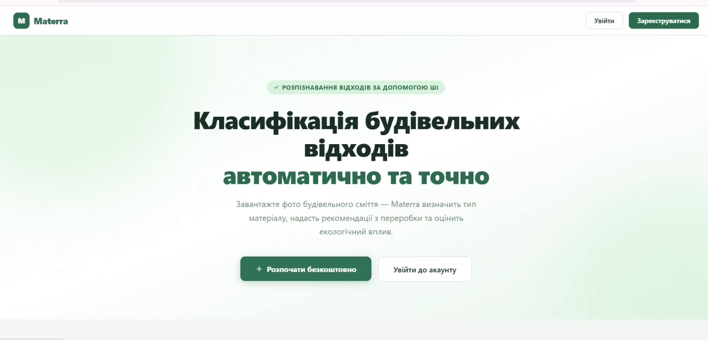
</p>

---

## What it does

Materra is an automated **construction & industrial waste classification service**. A user uploads a photo of a waste site or waste container; the server runs a vision model, resolves the image to one of **14 internal waste categories**, scores its ecological recoverability, and generates a recycling-recommendation PDF on demand.

The system is a **Django 5 REST API** backed by SQLite (dev) or PostgreSQL (prod). Inference runs **synchronously inside the request cycle** — there is no separate worker. Images are stored as bytes in the database, PDFs are streamed from memory, nothing is written to disk.

| | |
|---|---|
| **Status** | MVP 1.4 — landing page, full dashboard, classification, PDF reports, accounts |
| **Stack** | Python 3.11 · Django 5 · DRF · HuggingFace transformers · CLIP ViT-B/32 · ReportLab · pytesseract |
| **Inference** | CPU only (`device=-1`), 200–800 ms per image |
| **Hosting** | Single `web` container via Docker Compose |
| **Authors** | Almakadma M.I., Popova Ye.R. — Kharkiv National University of Radio Electronics |

---

## Why it exists

Construction & demolition waste is the largest waste stream in the EU. The headline ~89 % EU recovery rate is mostly **low-quality backfilling** — actual material-grade recycling lags far behind. Site operators sort by eye, which is slow, inconsistent, and biased toward easy materials.

Materra turns a phone photo into an immediate, repeatable classification + a recycling pathway anchored in EU data (Eurostat `cei_wm040`, JRC CDW Report JRC134500, EAPA, EU C&D Waste Protocol). The score is a static per-class constant chosen offline against those sources, not a black-box runtime calculation.

---

## Screenshots

### Public landing page

<table>
<tr>
<td></td>
<td>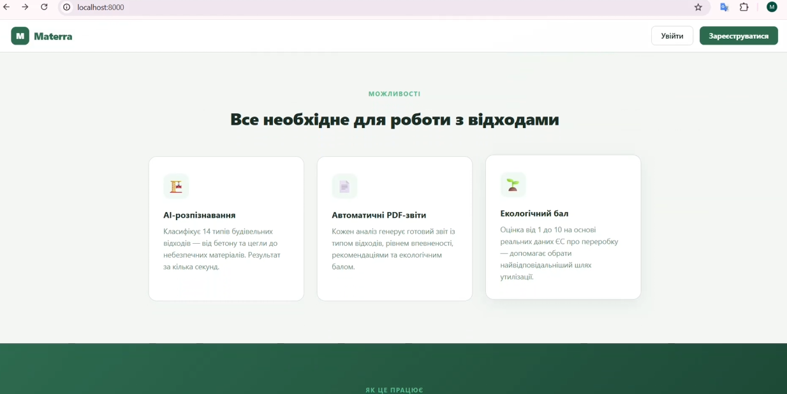</td>
</tr>
<tr>
<td align="center"><em>Hero — single-photo classification value prop</em></td>
<td align="center"><em>Feature cards — AI recognition, PDF reports, eco score</em></td>
</tr>
</table>

<p align="center">
  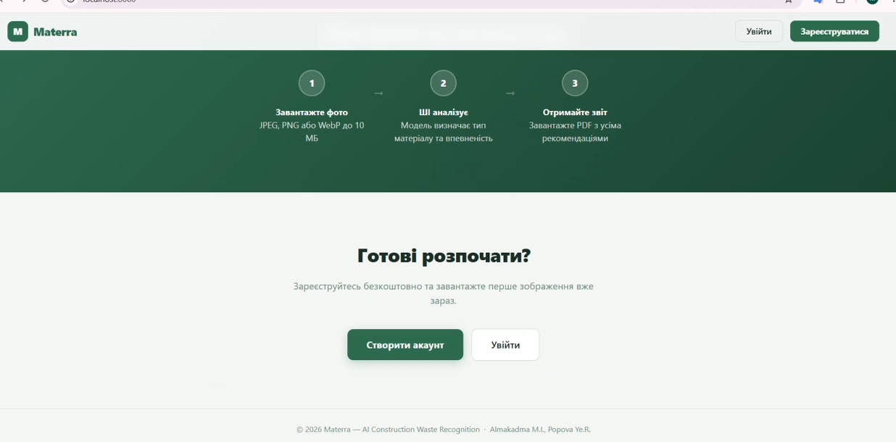
  <br><em>3-step flow: upload → AI analyse → PDF report</em>
</p>

### Authentication

<table>
<tr>
<td>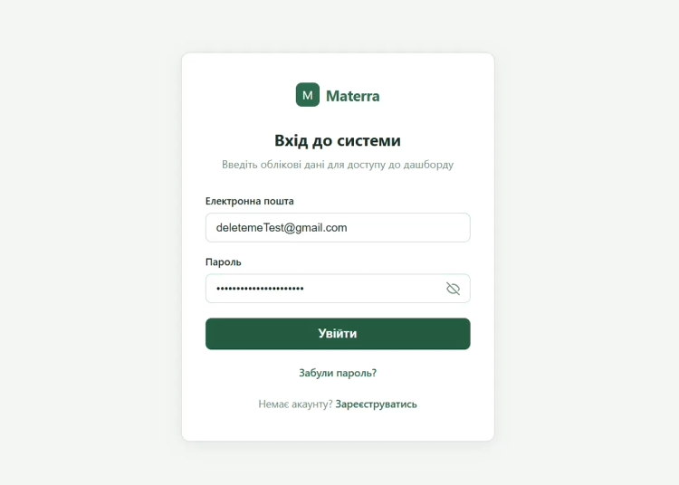</td>
<td>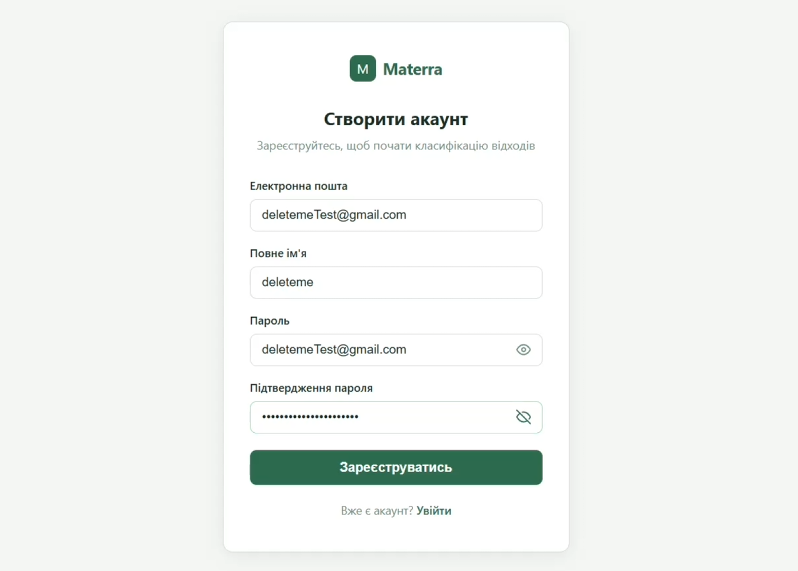</td>
</tr>
<tr>
<td align="center"><em>Login — Django session auth, email + password</em></td>
<td align="center"><em>Register — auto-login on success</em></td>
</tr>
</table>

### Dashboard

<p align="center">
  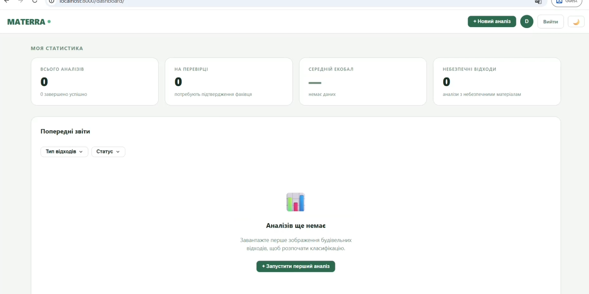
  <br><em>Empty state — KPI cards (total / review / eco score / hazardous) and a CTA</em>
</p>

<p align="center">
  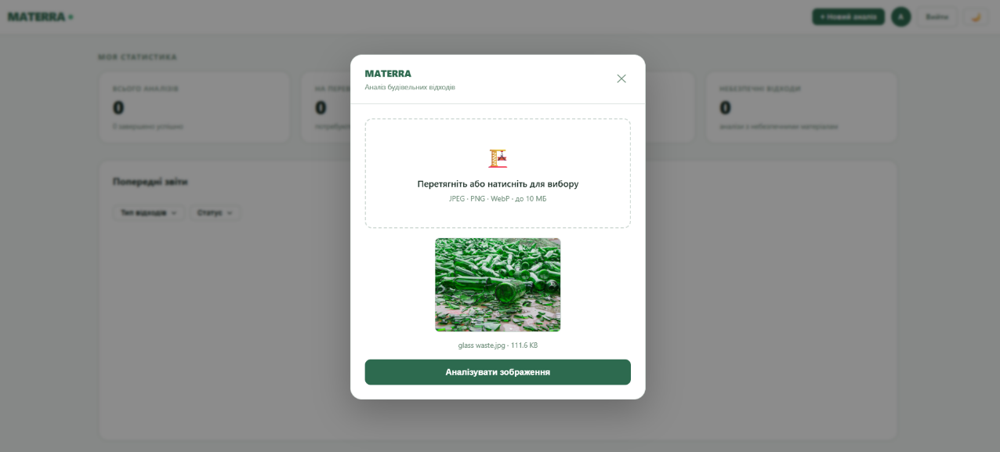
  <br><em>Upload modal — drag-drop, JPEG/PNG/WebP, ≤ 10 MB</em>
</p>

<p align="center">
  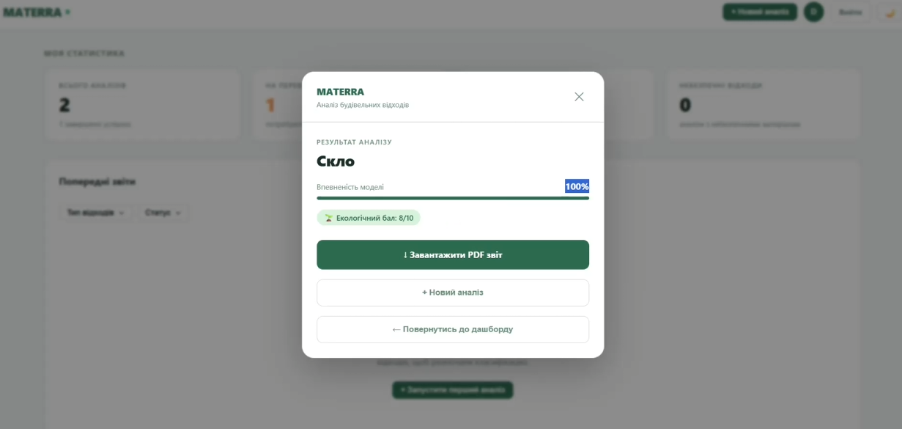
  <br><em>Result modal — class, confidence, eco badge, PDF link</em>
</p>

<p align="center">
  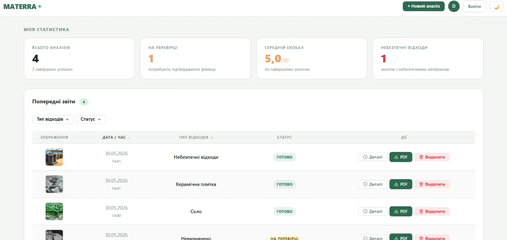
  <br><em>History table with live KPIs, sortable date, type/status filters, thumbnail lightbox</em>
</p>

<p align="center">
  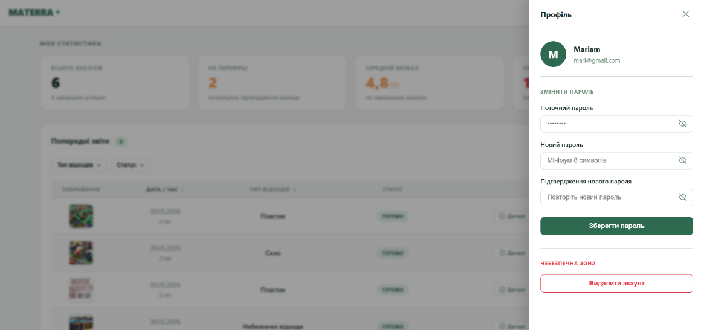
  <br><em>Profile drawer — change password, delete account</em>
</p>

### PDF report

<p align="center">
  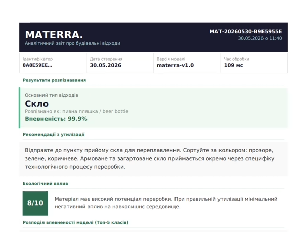
  <br><em>On-demand PDF: bilingual class, confidence, recycling guidance, eco badge, top-5 chart</em>
</p>

---

## How it works

```
Browser ──POST /api/v1/analyses/──▶ Django web
                                       │
                                       ├─ validate (magic bytes, ≤10 MB, Pillow verify)
                                       ├─ persist Analysis + AnalysisImage (bytes in DB)
                                       ├─ CLIP zero-shot vs 13 candidate phrases
                                       ├─ pytesseract OCR override (hazardous keywords)
                                       └─ gate: confidence ≥ 0.05 ? DONE : REVIEW_NEEDED
                                       │
Browser ──GET  /api/v1/analyses/{id}/──┘  (polls every 2 s)
Browser ──GET  /api/v1/reports/{id}/download/  → in-memory ReportLab PDF
```

The 14 waste classes are: `concrete`, `brick`, `metal`, `wood`, `glass`, `plastic`, `ceramic_tile`, `asphalt`, `gypsum`, `insulation`, `mixed_debris`, `soil`, `hazardous`, plus the `unknown` review sentinel.

Full diagrams (system topology, request sequence, analysis state machine, ER diagram, auth flow, deployment topology) live in [PROJECT_ARCHITECTURE.md](PROJECT_ARCHITECTURE.md).

---

## Quick start

### With Docker (recommended)

```bash
git clone https://github.com/NureAlmakadmaMariam/Materra.git
cd Materra
cp .env.example .env   # set DJANGO_SUPERUSER_PASSWORD to get a dev admin account
docker compose up --build
```

On first boot the container runs `migrate`, seeds a dev superuser (when `DJANGO_SUPERUSER_PASSWORD` is set in `.env`), and starts Django on `http://localhost:8000/`. The CLIP model (~600 MB) downloads from HuggingFace the first time `LocalAIService.classify()` is called.

### Without Docker

```bash
cd backend
python -m venv venv && source venv/Scripts/activate   # or venv/bin/activate on Linux/Mac
pip install -r requirements.txt
python manage.py migrate
python manage.py create_dev_superuser
python manage.py runserver
```

> **Note:** OCR hazard detection requires the Tesseract binary on the host (`tesseract` on PATH). If it is missing, OCR silently no-ops and CLIP still runs.

---

## Repo layout

```
Materra/
├── backend/
│   ├── apps/
│   │   ├── accounts/   # User model, login/register/profile/password-reset views
│   │   ├── ai/         # LocalAIService — CLIP singleton + OCR hazard check
│   │   ├── analyses/   # Analysis + AnalysisImage + WasteClass models, API
│   │   └── reports/    # PDF generator (ReportLab) + MyMemory translation cache
│   ├── materra/        # Django project settings (base + development + production)
│   ├── templates/      # landing.html, dashboard.html, login/register, profile
│   ├── static/
│   ├── Dockerfile
│   └── requirements.txt
├── img/readme/         # screenshots used by this README
├── weights/            # bind-mounted to /app/weights (model cache)
├── docker-compose.yml  # single `web` service
├── PROJECT_ARCHITECTURE.md
└── db_schema_notes.md
```

---

## REST API

| Method | Path | Purpose |
|---|---|---|
| `POST` | `/api/v1/analyses/` | Upload an image, returns `202 Accepted` with `poll_url` |
| `GET` | `/api/v1/analyses/{uuid}/` | Poll status; payload depends on terminal state |
| `DELETE` | `/api/v1/analyses/{uuid}/` | Delete an analysis + its image |
| `GET` | `/api/v1/analyses/{uuid}/image/` | Stream the uploaded image bytes |
| `GET` | `/api/v1/reports/{uuid}/download/` | Inline PDF · `?download=1` attachment · `?format=json` JSON |

All API views are `AllowAny`; when a Django session cookie is present the analysis is linked to that user, otherwise it is anonymous. Dashboard pages require login (`LoginRequiredMixin`).

---

## Acknowledgements

- **CLIP** — Radford et al., OpenAI (`openai/clip-vit-base-patch32`)
- **MyMemory** — free English → Ukrainian translation API (cached locally in the `LabelTranslation` table)
- **JRC CDW Report JRC134500**, **Eurostat `cei_wm040`**, **EAPA 2022**, **EU C&D Waste Protocol 2016** — sources for the per-class ecological scores

Course project, 2026.
